
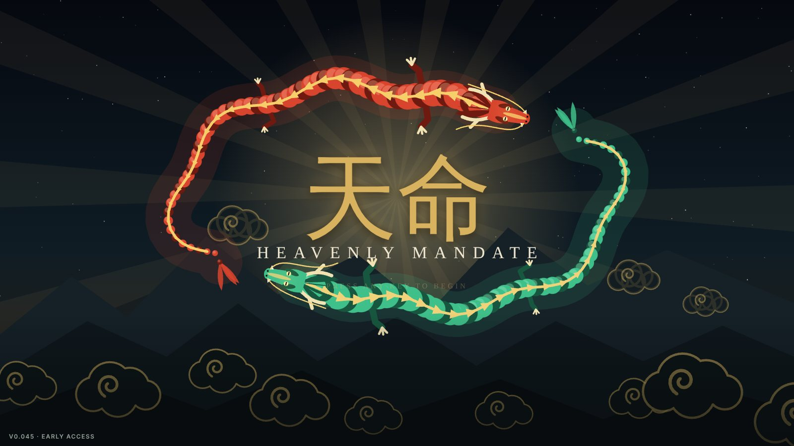

<h1 align="center">Heavenly Mandate · 天命</h1>

<b>A 5v5 online MOBA of Chinese myth and legend.</b> 
Lead an immortal and their summoned troops into ranked matchmaking against real players, or play offline against bots whenever there is no internet.

  <a href="https://github.com/MasterGrimReapper/heavenly-mandate/raw/main/android/HeavenlyMandate-Android.apk"><b>⬇ Android app (APK)</b></a> ·
  <a href="windows/README.md">Windows desktop</a> ·
  <a href="CHANGELOG.md">Changelog</a>

  
  
  

---

## Downloads

| Platform | File | Status |
|---|---|---|
| **Android** (phones and tablets) | [`android/HeavenlyMandate-Android.apk`](android/HeavenlyMandate-Android.apk) | Available, updates itself from inside the game |
| **Google Play** | Coming soon | In testing on Google Play now |
| **Windows** (desktop) | See [`windows/`](windows/README.md) | In development, Steam release planned |

The `.apk` file is **Android only**: it will not run on a Windows PC. The `updates/` folder is read automatically by the Android app; you never need to download anything from it.

## About the game

Heavenly Mandate is a MOBA in the spirit of League of Legends and Dota, built around the gods, heroes and monsters of Chinese mythology. Every match is five against five: push down the lanes, take the river bosses and shatter the enemy Heart of Heaven.

It is an **online multiplayer game** with ranked and casual matchmaking against real players on our own game server, and it keeps a **full offline mode** against bots for when there is no internet. Online play is on Android now and comes to the desktop version later. Offline, the other nine heroes are bots that farm, gank, rotate to objectives, answer your pings and fight as a team.

What makes it different: **every hero summons their own troop.** Sun Wukong calls Monkey Warriors, Hua Mulan brings Northern Riders, Zhu Bajie leads the Piglet Guard. Your troop follows you, attacks what you attack, defends you when you are hit, and evolves at levels 6, 11 and 16.

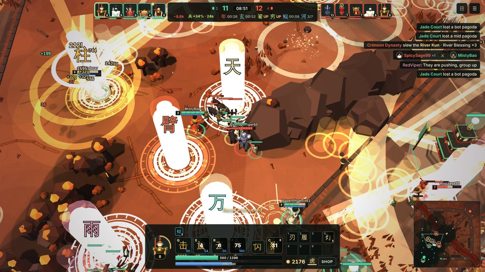

## Features

- **Online play:** Ranked 5v5, Quick Match, Bridge of Immortals and 1v1 Duel against real players, with matchmaking by skill, a draft, Glicko-2 ratings and court ranks from Mortal to the Jade Emperor's Court. Every phone runs the same battle in lockstep and the server checks every result, so matches are fair
- **15 immortals** across six roles (tank, fighter, assassin, mage, marksman and support), each with a passive, four abilities, two aspects and a summoned troop; more return in later updates
- **Twenty modes offline:** the full three-lane war, a fast double-speed version, a cloud-bridge brawl, a King of the River arena, one-on-one duels, all-random chaos, the Siege of Heaven horde mode, boss raids, two story campaigns, party modes and a practice ground
- **Seven battlefields:** Jade Valley, Kunlun Snowfield, Flaming Mountains, Maple Gorge, Lantern Night, Dunhuang Sands and the Heavenly Palace, each with its own weather, wildlife and light that turns from day to dusk as the match goes on
- **Objectives with a choice:** the Nian Beast, Black Tortoise and Golden Qilin; River Kun every minute and the Great Kunpeng every fifth; jungle camps, peach trees and golden koi
- **43 items and 8 battle spells,** a recommended build for every hero, and counter-build suggestions that read the enemy team
- **Bots with personalities:** aggressive, careful, objective-focused or farmers, on four difficulties from Disciple to Mythic
- **A post-match coach** that names your strongest contribution, one thing to improve and a way to practise it
- **Progression:** levels, coins, hero mastery, nearly 50 achievements, daily and weekly challenges, and cosmetic skins, troop skins, emblems, frames and titles
- **Replays** of every match, with playback speed and hero follow-cam
- **Resting and potions:** out of combat you slowly regain health and Qi; potions are one purchase with charges that refill at the Gate of Life
- **Recorded voices** for the narrator, five announcer packs and every immortal, in English and Mandarin; the whole game is in English and Simplified Chinese
- **Offline works without a connection.** The 3D world, the music and the sound are generated in the game. The only account is the online one, created automatically with no sign-up, which you can delete at any time from Settings › Online

## The immortals

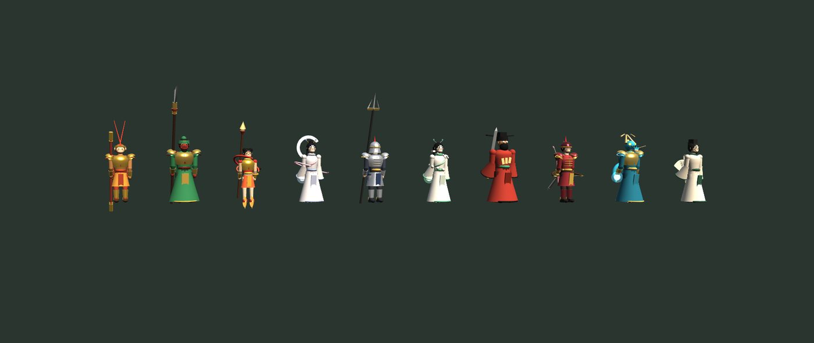

| Immortal | Title | Role | Troop | Ultimate |
|---|---|---|---|---|
| Sun Wukong | The Monkey King | Fighter | Monkey Warriors | Pillar of Heaven |
| Erlang Shen | The Three-Eyed God | Fighter | Celestial Hounds | Heavenly Gaze |
| Guan Yu | Saint of War | Tank | Shu Guandao Guard | Green Dragon Reaping |
| Zhu Bajie | Marshal of the Heavenly Canopy | Tank | Piglet Guard | Marshal of the Heavenly Canopy |
| Ao Guang | Dragon King of the East Sea | Tank | Crab General & Shrimp Soldiers | Wrath of the Sea |
| Bull Demon King | Great Sage Who Pacifies Heaven | Tank | Buffalo Cavalry | Great White Bull |
| Nezha | The Lotus Prince | Assassin | Fire Wheel Children | Three Heads Six Arms |
| Bai Gujing | The White Bone Demon | Assassin | Skeleton Soldiers | Devour the Pilgrim |
| Chang'e | Lady of the Moon | Mage | Jade Rabbit and the Moon Rabbits | Full Moon |
| Zhuge Liang | The Sleeping Dragon | Mage | Wooden Ox & Crossbowmen | Fire at Red Cliffs |
| Bai Suzhen | The White Serpent | Mage | Serpent Maidens | Rising Tide |
| Hou Yi | Shooter of the Suns | Marksman | Sun Crows | The Arrow That Felled the Suns |
| Hua Mulan | General of the North | Marksman | Northern Riders | Rain of Arrows |
| Mazu | Goddess of the Sea | Support | Lantern Maidens | Light of Meizhou |
| Jiang Ziya | Strategist of the Investiture | Support | Generals Heng and Ha | Investiture of the Gods |

Every hero has a legend to read in the gallery, difficulty and play-style ratings, and unlockable skins.

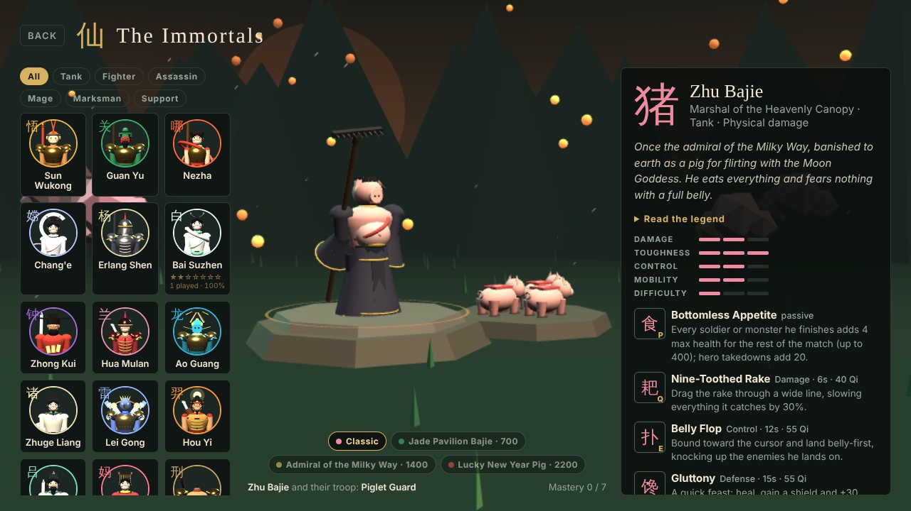 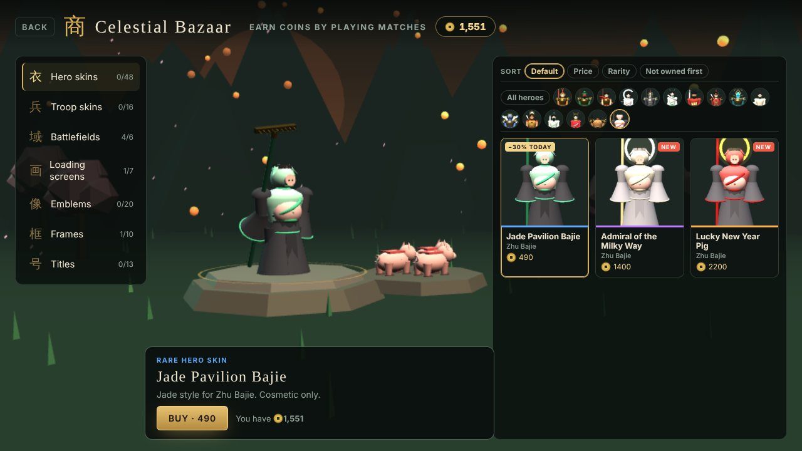

## Online play

Press **Play** and choose **Online** or **Offline**. Online, pick a queue: **Ranked** (5v5 Three Realms, real players only, with placements, divisions and seasons), **Quick Match**, **Bridge of Immortals** (both fill empty seats with bots after a minute) or **Duel** (1v1). The game connects to our hosted server by itself; the input delay follows your connection, a bot takes over for anyone who leaves, and you can rejoin a match you dropped from. Online needs internet; everything below works offline.

## Modes

| Mode | Players | Length | What it is |
|---|---|---|---|
| **Three Realms** | 5 v 5 | 12–21 min | The full war: three lanes, a jungle of monsters, river bosses and the Kunpeng. Destroy the enemy Heart of Heaven. |
| **Celestial Rush** | 5 v 5 | 8–15 min | The full map at double speed: start at level 4 with 2,000 gold, faster waves, weaker towers and quick respawns. |
| **Bridge of Immortals** | 5 v 5 | 6–15 min | One long bridge over a sea of clouds, base to base. Level 3 start, no recalling, overtime at 9:00. |
| **King of the River** | 5 v 5 | 5–8 min | A round arena with a control point at its centre. The team with more heroes on the point scores; first to 300 wins. |
| **Duel of Immortals** | 1 v 1 | 5–12 min | One hero each on the cloud bridge. Win with 3 takedowns, the first pagoda or the Heart. |
| **All Random** | 5 v 5 | 12–20 min | Three Realms with every hero chosen at random (one reroll each). |
| **Practice Grounds** | Solo | Free | You, the soldiers, the jungle and a training dummy. Instant levels, free gold, no cooldowns, infinite Qi and a DPS meter. |

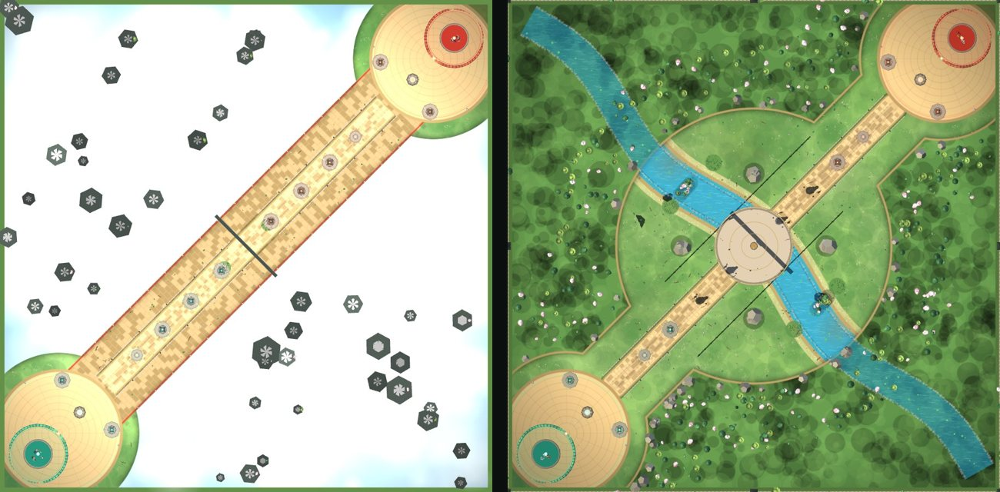

Left: the cloud bridge used by Bridge of Immortals and Duel. Right: the King of the River arena.

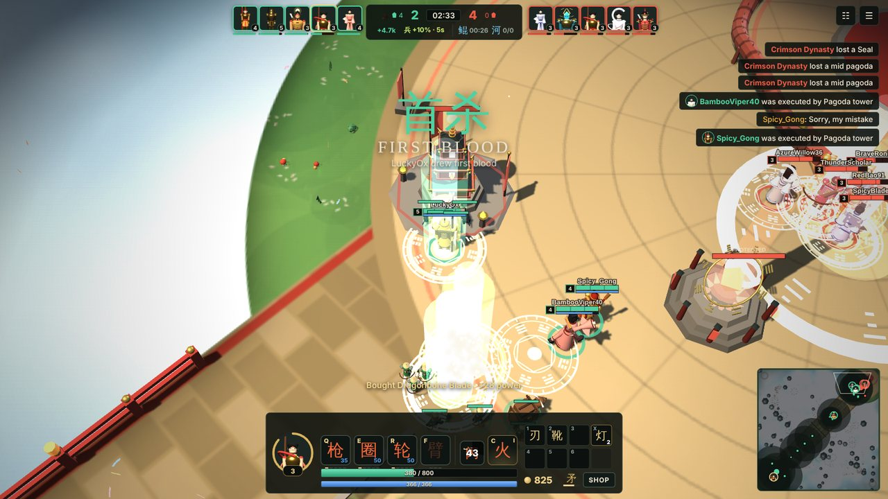

## How a match works

- **Lanes and pagodas.** Spirit soldiers march down each lane every 30 seconds. Behind them stand three pagoda towers, a Seal and the Heart of Heaven. Break the Heart to win.
- **Your troop.** Summon five troops to fight beside you. They follow your orders, attack your target and protect you.
- **Respawns.** A team's first death respawns in 8 seconds. Every death on that team, yours or a teammate's, adds 2 seconds, up to 60.
- **Gates of Life.** Each base has a spawn circle guarded by twin dragons. It heals you, it is where you shop, and it is death to enemies who step inside.
- **Bosses.** The Nian Beast and Black Tortoise empower your whole team. After 18:00 the Golden Qilin replaces the Nian Beast. River Kun blessings stack all game.

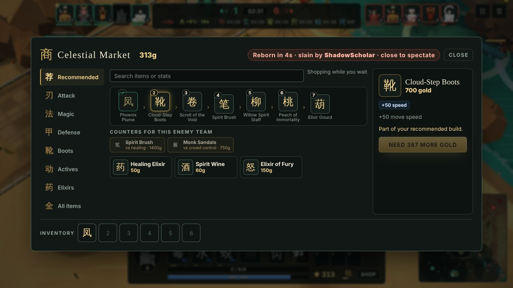 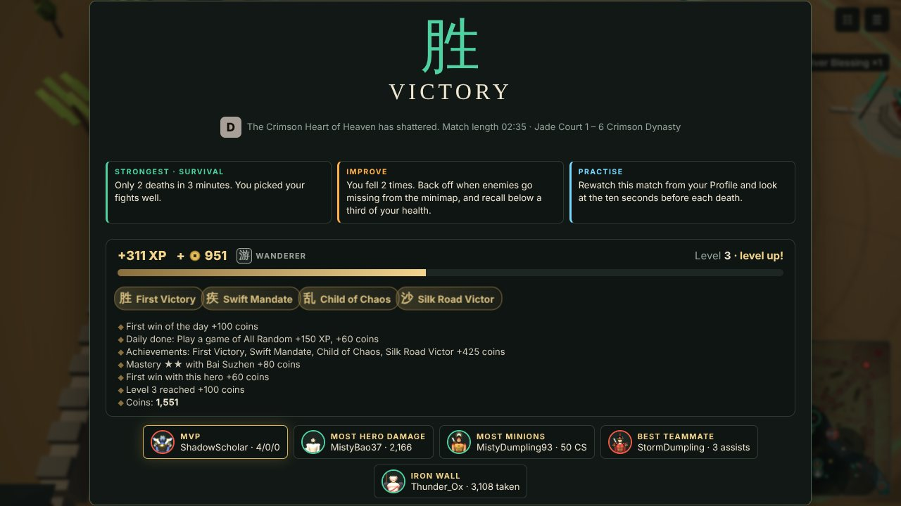

## Play on your phone

The Android app is the full game with touch controls built for phones:

- A thumb joystick on the left, an attack button and an arc of ability buttons on the right
- Every ability shows a picture of what it does, plus a badge for stuns, slows, roots and knock-ups
- Tap an ability to cast at the highlighted target, drag to aim, or slide back to cancel. Hold any button to read what it does
- While dead, drag to look around and pinch to zoom
- Settings for instant casting, button opacity, interface size, bold team rings and colour-blind team colours

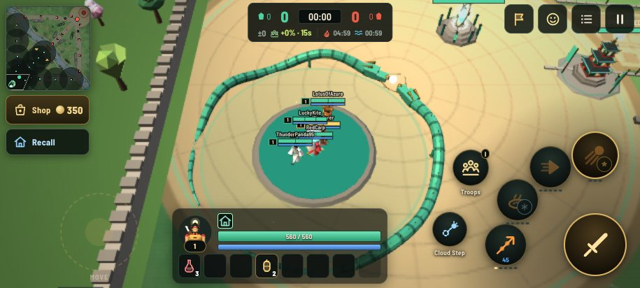

### Install

1. Download **[HeavenlyMandate-Android.apk](https://github.com/MasterGrimReapper/heavenly-mandate/raw/main/android/HeavenlyMandate-Android.apk)** on your phone.
2. Open it from your Downloads. The first time, Android asks you to allow installing apps from that source: allow it, go back and tap **Install**.
3. Needs Android 7.0 or newer and a phone with WebGL (any phone from the last several years).

### Updates

From v0.4.8 on, the app checks this page for a new version every time it starts. When one is out it shows what changed and offers **Download and update**. The new version downloads inside the game, Android's installer opens, and you tap **Install**. Your level, coins, unlocks and settings are kept. You can also check from **Settings › Gameplay › App updates**.

> Your progress is saved only on your phone. Clearing the app's data or uninstalling it erases it, so use **Settings › Gameplay › Back up your profile › Export** first.

## Controls (desktop)

| Action | WASD scheme | Classic scheme |
|---|---|---|
| Move | W A S D | Right-click the ground |
| Attack | Click an enemy | Right-click an enemy |
| Abilities | Q E R F | Q W E R |
| Summon or command troops | C | F |
| Battle spell | Space | D |
| Recall · Shop · Ward | B · P · X | B · P · 4 |
| Ping · Emote | G · T | G · T |
| Scoreboard · Pause | Tab · Esc | Tab · Esc |

Every key can be rebound in **Settings › Controls**, and abilities can be cast on release, on click or instantly.

## Opening

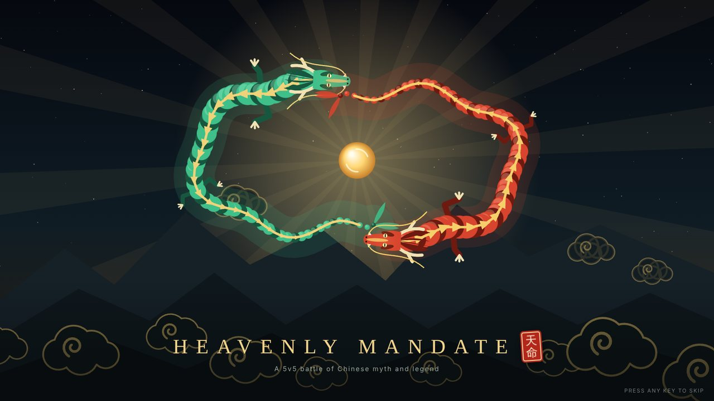

The game opens on rice paper. A drop of ink falls and blooms into a night sky where the jade and crimson dragons chase the Pearl of the Mandate. The pearl bursts and the title is stamped with a red seal.

## Status and roadmap

Heavenly Mandate is in **early access** and updated often. See the [changelog](CHANGELOG.md) for every release.

- Android: available here, with in-app updates; on Google Play soon
- Online play: live on Android, on our own hosted server
- Windows desktop: in development (offline only for now), with a Steam release planned
- Balance is tuned from seeded bot-vs-bot match batches; every release runs automated replay and simulation tests
- Next: online play on desktop, Google Play Games sign-in and leaderboards, the immortals returning to the roster

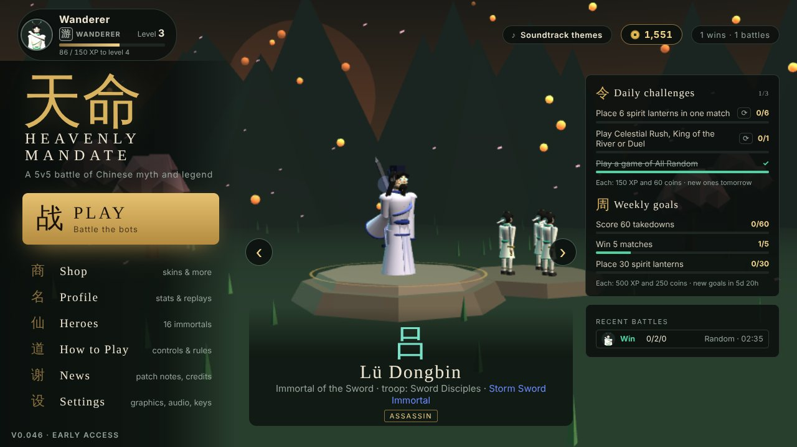 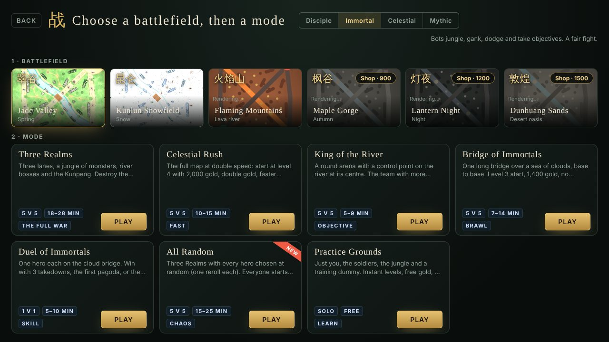

---

Heavenly Mandate © MasterGrimReapper. All rights reserved. Characters are drawn from Chinese mythology, folklore and classic literature.

